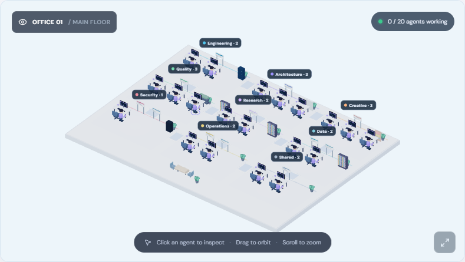

# Agent Office 🏢

**Open-source 3D mission control for local AI coding agents.** Inspect an animated office, assign Codex CLI, Claude Code or Gemini CLI tasks, follow execution events, and track task history. Built with React, TypeScript, React Three Fiber, Three.js, and Node/Express.

> **Project status: functional prototype (v0.3).** Agent profiles are configurable visual task slots backed by separate CLI executions. They do not yet share memory, delegate or form a coordinated multi-agent workflow. Idle walks and coffee breaks are ambient visual behavior, not real agent communication or task progress. In Demo mode, all activity is simulated and no code is executed. Codex is the most extensively tested provider; Claude Code support is experimental and Gemini CLI support has not been tested on a machine with Gemini installed.


## Try the interactive demo online

**[Open the public browser demo](https://munizada.github.io/agent-office/)** — explore the 3D office, customize rooms, add/edit/delete agent profiles, and simulate tasks in your own browser. **No installation or AI account is needed.** The preview never connects to a local CLI or sends commands to the maintainer's computer. Agent profile and appearance changes stay in each visitor's own browser storage; simulated task activity resets on reload. The GitHub Actions workflow publishes the demo whenever `main` changes.

**Maintainer setup:** GitHub Pages must use **GitHub Actions** as its deployment source under repository **Settings → Pages**. If Pages is not enabled, this one-time setting is required before the first deployment succeeds. The URL above works only after GitHub reports a successful `Public interactive demo` deployment; see the [deployment workflow](.github/workflows/demo-pages.yml).

## Requirements

- Node.js 20.19+ / 22.12+ (tested on Node 24) and npm.
- A browser with WebGL enabled.
- At least one installed and authenticated CLI for real tasks: [Codex CLI](https://github.com/openai/codex), [Claude Code](https://code.claude.com/docs/en/quickstart), or [Gemini CLI](https://github.com/google-gemini/gemini-cli).

## Quick start

**Install once** (Windows, Linux or macOS):

```bash
npm install -g https://github.com/Munizada/agent-office/releases/latest/download/agent-office.tgz
```

Then, in **any project folder**, run:

```bash
agent-office
```

The office opens at **http://127.0.0.1:4300/** and uses the terminal's current folder as its default workspace. Keep the terminal open while using it (Ctrl+C stops the office). On PowerShell, if `npm` is blocked by script policy, substitute `npm.cmd` in the install command. You need Node.js and npm installed. Re-run the same command to update to the latest prebuilt GitHub release. Installing the release archive avoids requiring TypeScript or other development tools on the user's machine.

Options: `agent-office --no-open` (start without opening your browser), `agent-office --port 4400` (use a different port), or `agent-office --workspace /path/to/project` (select another project directory). For VS Code's integrated terminal, `agent-office` also works directly.

**Inside VS Code:** install the companion extension `.vsix` from [GitHub Releases](https://github.com/Munizada/agent-office/releases), then use **Ctrl+Shift+P → Agent Office: Open 3D Office**. The office appears in a VS Code tab and automatically uses the open project folder. See [VS Code extension guide](vscode-extension/README.md). Other editors can use the browser interface launched from their integrated terminals.

**Linux/macOS or development:** Run from this folder:

```bash
npm ci
npm run dev:all
```

Open **http://127.0.0.1:5173/** for development. For a built production UI use `npm run build` then `npm start` and open **http://127.0.0.1:4300/**. The interface starts in **Demo mode**. To run real tasks: authenticate your CLI, select **Live mode**, create a task, choose the AI provider, assign an avatar and select an absolute project directory. Unavailable providers are disabled.

If you prefer separate terminals, use:

```bash
npm run server
```

And in the second terminal:

```bash
npm run dev
```

When launched via `agent-office`, real tasks default to your terminal's current directory; when started from the source using `npm run dev:all`, they default to this project's root. Change the folder in Settings if needed. Each task starts a new CLI process with its own prompt. Agent profiles represent independent task slots; they do not observe existing external chat sessions or automatically coordinate. The server rejects overlapping workspace folders while its own tasks are running.

### 🏢 Flexible team and expanding office

Open **Agent team → Add agent** to create as many profiles as your setup needs. The original four agents are starting examples, **not a limit**: 0, 1, 10, 20, 50 and larger teams are supported by the roster and office layout. Edit each agent's name, role, mission/specialty, color and department, or remove agents when they are no longer needed. The app suggests a department when your role or mission clearly indicates one; you can override the suggestion. Unrecognized roles use shared workstations rather than being assigned to an unrelated themed area.

The 3D office is a shared open-plan workspace with nine possible team bays: architecture, engineering, design, quality assurance, research, data/analytics, security, operations and shared space. Team bays have contextual props and floor accents without enclosing workers in separate rooms. The floor includes a glass-and-metal corporate facade and expands with the roster: agents get a compact coffee corner, three agents add a meeting area, and 25 add a focus nook. Idle agents can walk to the kitchenette, pause with a mug and return to their stations; the visit is spaced across the team to avoid crowding. Teams with more than one agent open with an automatically fitted overview. Select an agent card to focus its workstation, then use the bottom-right overview button to see the entire office. To protect 3D performance, **teams over 50 render the 50 nearest detailed animated workstations plus simplified characters and furniture for every remaining agent**; click a distant character or select its card to load the detailed workstation. A large roster does not mean that the machine can run that many CLI jobs simultaneously. CPU/RAM, provider limits and the existing one-job-per-overlapping-project guard still apply.

**Customize your office in Settings → Office appearance:** choose bright white/daylight, midnight or warm color palettes; compact, balanced or spacious layouts; an office-wide accent color; and individual colors for all nine departments. Pick off, subtle or lively avatar movement. Open team bays and connecting aisles are regenerated from the live roster and department assignments. Appearance preferences persist in the current browser; agent profiles and task history remain in the local API data directory. A working agent returns along clear aisles, approaches the chair, sits facing the monitor and stays seated until the activity ends. When idle, an agent can take a routed coffee break: it walks to the shared kitchenette, lifts a mug for a sip, waits briefly and returns to its post. Movement preferences control this behavior. Coffee breaks are ambient presentation only; task phase/status remains tied to API execution events, and the characters do not claim to be having a real conversation or completing work. See [the reference decision record](docs/REFERENCE-DECISIONS.md) for ideas reviewed from related open-source projects.



Profiles are saved locally in `agents.json` next to the private task history, survive restarts, and are scoped to the current Agent Office data directory. You can safely remove the last agent and rebuild your team from zero. Finished task history stays intact when its agent is removed. Demo mode only simulates activity for existing sample agents; it never consumes CLI tokens.

**Codex Web GPT / Codex desktop integration:** If you use [Codex Web GPT](https://github.com/miuuyy/codex-chatgpt-web), choose the same repository folder to launch a fresh independent CLI task there. The Agent Office does not connect to its tunnel, Native2 bridge, chat, or existing Codex processes. Avoid modifying the same files concurrently in the two apps; the folder conflict guard cannot detect external applications. Your Codex Web GPT configuration and authentication are never changed by setup.

### 🌐 Interface languages

Open **Settings → Language** and select one of 20 interface languages, including **Português (Brasil)**, Portuguese (Portugal), English, Spanish, French, German, Italian, Dutch, Polish, Russian, Ukrainian, Turkish, Arabic, Hindi, Simplified and Traditional Chinese, Japanese, Korean, Indonesian and Vietnamese. The selection applies immediately and is stored in your browser; a first visit uses your browser language when supported, otherwise English. Language selection is available on mobile as well.

Built-in static translations cover the interface; automatically translated labels may benefit from native-speaker review. Your own task prompts, Codex output, error messages and file paths remain unchanged, while example/demo activity is translated when it matches the built-in sample strings. No online translation API is needed while using the app.

To override CLI discovery or set the initial project directory:

```powershell
$env:CODEX_BIN = 'C:\path\to\codex.exe'
$env:CLAUDE_BIN = 'C:\path\to\claude.exe'
$env:GEMINI_BIN = 'C:\path\to\gemini'
$env:AGENT_OFFICE_WORKSPACE = 'C:\path\to\your-project'
npm run server
```

## What works

- Rotate and zoom the 3D office; click an avatar to inspect their task. The characters react visually to their reported phases: thinking, coding, researching, finishing, or idle. A completed task triggers a brief celebration; a failed/interrupted task triggers an error reaction. Phase labels follow the interface language.
- Customize themes, seating density, department colors, office accent and avatar movement. Idle avatars can walk along clear aisles between their workstation and their team's shared area. Appearance settings stay on this browser and can be reset at any time.
- Launch an independent CLI task per avatar, choosing Codex, Claude Code or Gemini per task and targeting an absolute local project directory. Provider detection is performed at API startup; restart after installation.
- Stream command, file-change, research and progress events to the office through Server-Sent Events (SSE).
- Inspect a selected agent's execution phase, live elapsed time, latest update, chronological event details, errors and token usage (when reported by Codex). Select a task from the feed or history to inspect that exact run.
- Track finished jobs, latest status and task history; request cancellation.
- Explore the whole interface in Demo mode without spending API tokens or executing commands.
- Create, edit and delete agent profiles; assign meaningful departments and expand the 3D office with no fixed number of slots.

## Scripts

| Command | Action |
| --- | --- |
| `npm run dev` | Local front end at 127.0.0.1:5173 |
| `agent-office` | Run the globally installed office for the current project |
| `agent-office --no-open --port 4400` | Run headlessly on a different local port |
| `npm run package:vscode` | Build VS Code VSIX installer in `work/` |
| `npm run dev:all` | Start both front end and local API in one terminal |
| `npm start` | Serve built UI and local API at 127.0.0.1:4300 (run `npm run build` first) |
| `START-WINDOWS.cmd` | Older Windows starter, retained for compatibility |
| `npm run server` | Local AI CLI bridge at 127.0.0.1:4300 |
| `npm run build` | Type-check and production build |
| `npm run lint` | Static code checks |
| `npm run test:behavior` | Test agent behavior and CLI adapter / folder-safety rules without real AI jobs |
| `npm run check:server` | Validate server syntax |
| `npm run smoke:browser` | Smoke-test UI, visual 3D rendering and WebGL (both services running, Chrome needed) |
| `npm run smoke:roster` | Start an isolated local office, test real agent-management UI, and check 0, 1, 20, 50 workstations without launching AI jobs (Chrome needed) |
| `npm run smoke:avatars` | Capture isolated 3D character poses while working, thinking, sitting, and walking; check WebGL and browser errors (Chrome needed, images saved locally in ignored `work/`) |
| `npm run smoke:live` | **Runs real Codex jobs and consumes tokens**; tests parallel isolated file writes and API protections |
| `npm run smoke:live-ui` | **Runs a real Codex job and consumes tokens**; verifies launch, live 3D reactions, timeline and result through Chrome |

## Safety and privacy

The API listens only on `127.0.0.1:4300` and restricts browser origins. Each Codex job requests a `workspace-write` sandbox; Claude Code uses `acceptEdits` with noninteractive prompts denied; Gemini CLI uses `auto_edit`. These settings remain subject to your installed CLI and operating system permissions. Assign jobs only inside trusted project folders. The office blocks parallel tasks in overlapping directories **inside the office**, but cannot block jobs launched by Codex Web GPT, your editor or a second Agent Office instance.

CLI detection checks whether a command is installed, **not whether you are signed in**. A missing or expired login is reported by the CLI when a real task starts. For Claude Code, reauthenticate using its normal login flow in the Claude Code app/terminal before retrying the office.

`smoke:live` creates disposable test directories inside `.local/`; it runs two real Codex sessions, so it requires an authenticated CLI and can incur usage costs. Do not run it as part of an untrusted CI workflow.

Task prompts, statuses, phase updates, recent events (up to 35 per task) and short output excerpts are saved locally in `.local/tasks.json`, and editable agent profiles in `.local/agents.json`, during source development. Globally installed CLI data lives in a folder specific to each workspace under your user state directory (`%LOCALAPPDATA%\\AgentOffice` on Windows, `~/.local/state/agent-office` on Linux, etc.). This prevents separate project windows from overwriting each other's history and roster. These files are not committed. Avoid putting credentials in task instructions. The API has no user authentication and must **never** be exposed publicly on a network.

## Roadmap

- True multi-agent planning, handoffs, coordination, shared context, and delegation.
- More provider integrations and full real-world cross-platform testing for Gemini CLI and Claude Code.
- Drag-and-drop room layout editing, custom furniture, shared lounge areas, and richer agent appearance customization.
- Marketplace publication for the VS Code extension and standalone desktop packages. A manually installable VSIX is available through GitHub Releases.

## Contributing

Contributions and issue reports are welcome. Clearly distinguish simulated actions from real tool executions. License: MIT (see [LICENSE](LICENSE)).

## Documentation

- [Architecture and directory structure](docs/ARCHITECTURE.md)
- [Installation, development and GitHub synchronization](docs/DEVELOPMENT.md)
- [Contributing](CONTRIBUTING.md)
- [Security and privacy](SECURITY.md)

Before publishing a public update, run `npm run verify:public`. This checks tracked files for common secrets and personal paths, validates the code, and builds the application. The configured Git pre-push hook runs the same checks automatically. On the configured main branch, each commit is pushed automatically after pre-push verification when local hooks are enabled (`git config core.hooksPath .githooks`). Uncommitted edits never upload themselves.
