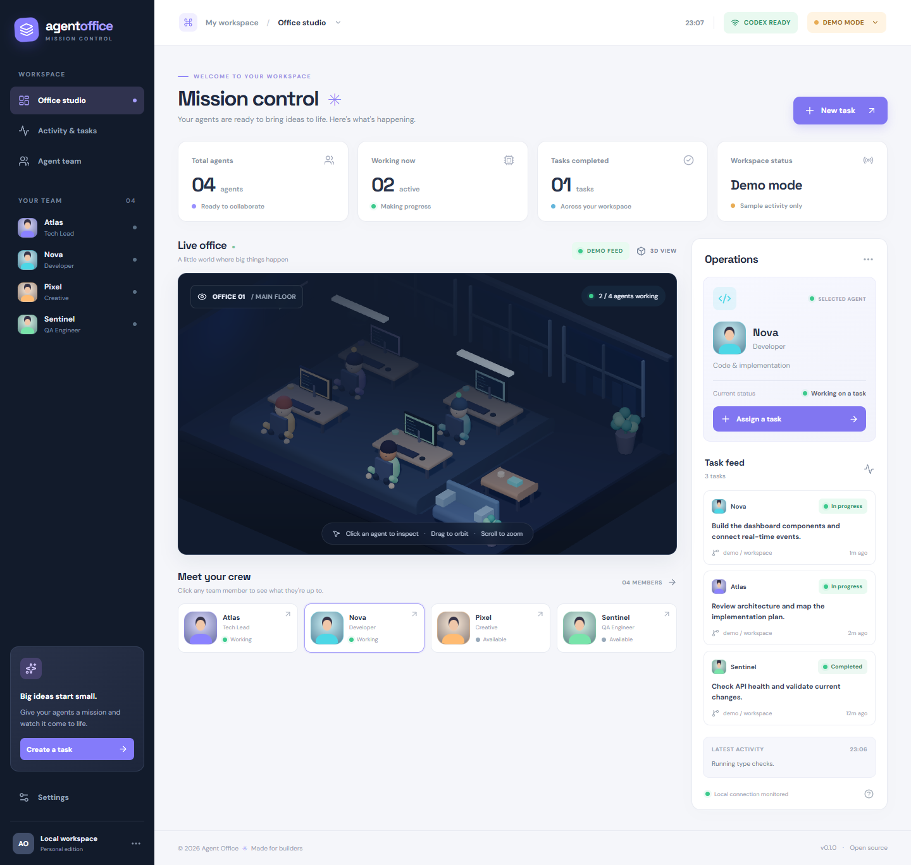

# Agent Office 🏢

**Open-source 3D mission control for local AI coding agents.** Inspect an animated office, assign Codex CLI tasks, follow execution events, and track task history. Built with React, TypeScript, React Three Fiber, Three.js, and Node/Express.

> **Project status: functional prototype (v0.1).** The four avatars are visual task slots backed by separate Codex CLI executions. They do not yet share memory, delegate or form a coordinated multi-agent workflow. In Demo mode, all activity is simulated and no code is executed.



## Requirements

- Node.js 20.19+ / 22.12+ (tested on Node 24) and npm.
- A browser with WebGL enabled.
- [Codex CLI](https://github.com/openai/codex) installed and authenticated, for real tasks.

## Quick start

Run from this folder:

```bash
npm ci
npm run dev:all
```

Open **http://127.0.0.1:5173/**. The interface starts in **Demo mode**. Switch the header to **Live mode** to launch real Codex jobs, once the status says **CODEX READY**.

If you prefer separate terminals, use:

```bash
npm run server
```

And in the second terminal:

```bash
npm run dev
```

By default, real tasks use this project's root folder. Set a different absolute **Project directory** in Settings before launching a task against another project.

### 🌐 Interface languages

Open **Settings → Language** and select one of 20 interface languages, including **Português (Brasil)**, Portuguese (Portugal), English, Spanish, French, German, Italian, Dutch, Polish, Russian, Ukrainian, Turkish, Arabic, Hindi, Simplified and Traditional Chinese, Japanese, Korean, Indonesian and Vietnamese. The selection applies immediately and is stored in your browser; a first visit uses your browser language when supported, otherwise English. Language selection is available on mobile as well.

Built-in static translations cover the interface; automatically translated labels may benefit from native-speaker review. Your own task prompts, Codex output, error messages and file paths remain unchanged, while example/demo activity is translated when it matches the built-in sample strings. No online translation API is needed while using the app.

To override CLI discovery or set the initial project directory:

```powershell
$env:CODEX_BIN = 'C:\path\to\codex.exe'
$env:AGENT_OFFICE_WORKSPACE = 'C:\path\to\your-project'
npm run server
```

## What works

- Rotate and zoom the 3D office; click an avatar to inspect their task. The characters react visually to their reported phases: thinking, coding, researching, finishing, or idle. A completed task triggers a brief celebration; a failed/interrupted task triggers an error reaction. Phase labels follow the interface language.
- Launch an independent Codex CLI task per avatar, targeting an absolute local project directory.
- Stream command, file-change, research and progress events to the office through Server-Sent Events (SSE).
- Inspect a selected agent's execution phase, live elapsed time, latest update, chronological event details, errors and token usage (when reported by Codex). Select a task from the feed or history to inspect that exact run.
- Track finished jobs, latest status and task history; request cancellation.
- Explore the whole interface in Demo mode without spending API tokens or executing commands.

## Scripts

| Command | Action |
| --- | --- |
| `npm run dev` | Local front end at 127.0.0.1:5173 |
| `npm run dev:all` | Start both front end and local API in one terminal |
| `npm run server` | Local Codex bridge at 127.0.0.1:4300 |
| `npm run build` | Type-check and production build |
| `npm run lint` | Static code checks |
| `npm run test:behavior` | Test the mapping from task events to 3D reactions (no Codex jobs) |
| `npm run check:server` | Validate server syntax |
| `npm run smoke:browser` | Smoke-test UI, visual 3D rendering and WebGL (both services running, Chrome needed) |
| `npm run smoke:live` | **Runs real Codex jobs and consumes tokens**; tests parallel isolated file writes and API protections |
| `npm run smoke:live-ui` | **Runs a real Codex job and consumes tokens**; verifies launch, live 3D reactions, timeline and result through Chrome |

## Safety and privacy

The API listens only on `127.0.0.1:4300` and restricts browser origins. Each Codex job requests a `workspace-write` sandbox, subject to your Codex configuration and operating system policies. Assign jobs only inside trusted project folders. Running agents in the same folder may edit the same files and interfere with each other.

`smoke:live` creates disposable test directories inside `.local/`; it runs two real Codex sessions, so it requires an authenticated CLI and can incur usage costs. Do not run it as part of an untrusted CI workflow.

Task prompts, statuses, phase updates, recent events (up to 35 per task) and short output excerpts are saved locally in `.local/tasks.json`, excluded from Git. Avoid putting credentials in task instructions. The API has no user authentication and must **never** be exposed publicly on a network.

## Roadmap

- True multi-agent planning, handoffs, coordination, shared context, and delegation.
- Adapters for other coding agents (Claude Code, Gemini CLI) with clear permission boundaries.
- Further character movement around the office and workspace customization.
- Desktop distribution, setup wizard and more comprehensive live execution tests.

## Contributing

Contributions and issue reports are welcome. Clearly distinguish simulated actions from real tool executions. License: MIT (see [LICENSE](LICENSE)).

## Documentation

- [Architecture and directory structure](docs/ARCHITECTURE.md)
- [Installation, development and GitHub synchronization](docs/DEVELOPMENT.md)
- [Contributing](CONTRIBUTING.md)
- [Security and privacy](SECURITY.md)

Before publishing a public update, run `npm run verify:public`. This checks tracked files for common secrets and personal paths, validates the code, and builds the application. The configured Git pre-push hook runs the same checks automatically. On the configured main branch, each commit is pushed automatically after pre-push verification when local hooks are enabled (`git config core.hooksPath .githooks`). Uncommitted edits never upload themselves.
